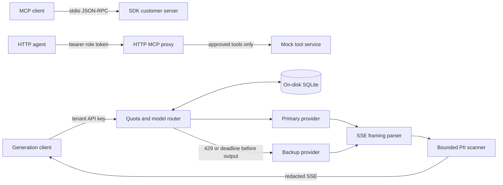

# Solution Architect assessment

Runnable Python implementations of the four tasks: a customer MCP stdio server, an authenticated HTTP tool proxy, streaming PII redaction, and SQLite-backed token admission with model fallback. Customer records, refunds, credentials, and providers are synthetic.

## Run locally

Use Python 3.12 and `uv` 0.13.7. From this repository:

```text
python -m pip install uv==0.13.7
uv sync --locked
uv run pytest -q
uv run ruff check src tests
uv run ruff format --check src tests
uv run mypy
uv run python -m assessment.demo
```

The demo starts two loopback servers on available ports, uses a temporary **on-disk** SQLite database, exercises all four tasks, prints measured streaming latency, and stops its servers. It needs no provider credentials. It includes a real 3-second timeout; the automated tests instead use controllable clocks, events, and immediate test deadlines. The default test suite is offline after dependencies are installed. See [VERIFICATION.md](VERIFICATION.md) for actual results and host-specific setup details.

For persistent servers, optionally copy `.env.example` to `.env` (`Copy-Item .env.example .env` in PowerShell; `cp .env.example .env` in a POSIX shell). The same synthetic settings are the defaults. Start these in separate terminals:

```text
uv run uvicorn assessment.mock:app --host 127.0.0.1 --port 8001 --no-proxy-headers
uv run uvicorn assessment.app:create_app --factory --host 127.0.0.1 --port 8000 --no-proxy-headers
```

Run the stdio server independently with:

```text
uv run python -m assessment.mcp_server
```

Use this command as an MCP client's subprocess command. Its stdin/stdout carry newline-delimited JSON-RPC; application logs go to stderr. `assessment.demo` also exercises it through the official SDK client.

For HTTP examples, the following work in PowerShell (`curl.exe`) and POSIX shells (`curl`); use the appropriate executable name:

```text
curl.exe -s http://127.0.0.1:8000/mcp -H "Authorization: Bearer dev-viewer-token" -H "Content-Type: application/json" --data-raw '{"jsonrpc":"2.0","id":1,"method":"tools/list"}'
curl.exe -s http://127.0.0.1:8000/mcp -H "Authorization: Bearer dev-viewer-token" -H "Content-Type: application/json" --data-raw '{"jsonrpc":"2.0","id":2,"method":"tools/call","params":{"name":"admin_reset_key"}}'
curl.exe -s http://127.0.0.1:8000/v1/completions -H "Authorization: Bearer dev-tenant-key" -H "Content-Type: application/json" --data-raw '{"prompt":"Synthetic demo","scenario":"primary429"}'
curl.exe -N http://127.0.0.1:8000/v1/generate -H "Authorization: Bearer dev-tenant-key" -H "Content-Type: application/json" --data-raw '{"prompt":"Synthetic demo"}'
```

PowerShell 7.3+ preserves these native arguments. On older Windows PowerShell, use the Python demo to avoid its native JSON quoting differences. Other mock scenarios are `ok`, `primary_timeout`, `backup_failure`, and `broken_stream`. The scenario field is a development provider feature, not a public provider API.

## Architecture and transport scope



`/mcp` is a constrained, stateless HTTP/JSON-RPC proxy for `tools/list` and `tools/call`. It does **not** implement MCP Streamable HTTP initialization, sessions, resumability, GET/SSE streams, or protocol-version negotiation. Do not point a general Streamable HTTP MCP client at it. Task 1 is the interoperable SDK stdio endpoint. The downstream mock is a separate service rather than a hidden bypass around the proxy.

## Task 1: validation and protocol errors

`mcp_server.py` uses strict Pydantic models: ASCII `CUST-` plus five digits; no extra fields; a finite positive JSON number; a strict string reason with at least ten characters after trimming. Booleans and numeric strings are rejected. JSON integer amounts convert directly to `Decimal`; parsed floating amounts convert using `Decimal(str(value))`. This avoids additional binary arithmetic error but cannot recover decimal precision already lost while parsing a JSON floating literal. Refund output reports the decimal as a string. No currency rounding policy or real payment execution is implied.

The implementation pins official `mcp==1.25.0`. Its ordinary `Server.call_tool()` decorator returns `CallToolResult(isError=True)` both for schema validation failures and caught exceptions, including `McpError`. That would not meet this assessment's explicit `-32602` requirement. The small adaptation registers typed list/call handlers in the public low-level `request_handlers` registry; a validation failure raises `McpError(ErrorData(INVALID_PARAMS, ...))` and the SDK request dispatcher emits a JSON-RPC error. There is no SDK monkey patch or private-method override.

The SDK's stdio reader turns malformed JSON into an exception on the input stream, and the server logs that exception instead of replying with a parse error. The public `stdin`/`stdout` injection parameters therefore receive duck-typed adapters: ingress validates raw lines, and a shared locked writer serializes both SDK messages and rejected-line replies. Two localized typing suppressions describe that file-interface mismatch. Initialization, session state, cancellation notifications, result serialization, and message delivery remain SDK behavior. The implementation was checked against the [pinned tool-handler source](https://github.com/modelcontextprotocol/python-sdk/blob/v1.25.0/src/mcp/server/lowlevel/server.py), [stdio source](https://github.com/modelcontextprotocol/python-sdk/blob/v1.25.0/src/mcp/server/stdio.py), and installed source, then exercised in a subprocess.

Wire errors use `-32700` for malformed/ambiguous JSON, `-32600` for invalid envelopes/batches, `-32601` for unsupported methods, and `-32602` for invalid method or tool parameters. IDs must be MCP strings/integers; booleans and explicit null IDs are rejected. Unparseable input has error ID null. Duplicate members are rejected before forwarding to prevent disagreement between JSON decoders. Valid tool notifications are ignored and cannot execute a refund.

## Task 2: authorization and forwarding

`app.py` resolves SHA-256 bearer-token digests against a configured development token-to-role map. It never trusts a decoded JWT claim. `tools/list` is forwarded, including its original request bytes and successful response bytes; both tool names remain discoverable to viewers as required. For calls, a name starting with `admin_` requires `admin`. A denied request preserves its ID and returns exactly `-32001: Unauthorized Tool Call`, with zero downstream requests.

Malformed JSON/envelopes return HTTP 400 plus JSON-RPC errors; valid method/authorization errors use HTTP 200 plus JSON-RPC errors. Missing/invalid credentials use HTTP 401 with a sanitized gateway payload and `WWW-Authenticate: Bearer`. Authenticated valid notifications receive empty HTTP 204 and are never forwarded, including unsupported methods; malformed envelopes still receive an invalid-request error. Unknown request methods return `-32601`. Upstream transport/status/body failures return HTTP 502 and `-32002`. Valid downstream JSON-RPC errors preserve the code and ID but replace the message and remove error data.

The HTTP proxy validates envelopes and method parameters, caps request bodies at 64 KiB and upstream responses at 256 KiB, disables redirects and environment proxy inheritance, and forwards no caller headers. It rejects explicit null tool parameters and checks upstream replies for duplicate JSON members before forwarding successful response bytes. The shared HTTPX client rejects upstream cookies to keep requests from inheriting another caller's upstream session. Downstream addresses come from operator configuration.

## Task 3: streaming redaction policy

`provider.py` incrementally decodes UTF-8 and parses LF/CRLF SSE, including multiline `data`, independently of network chunk boundaries. The local provider contract is JSON `{ "delta": "text" }`, an optional final usage event, and a required `data: [DONE]`. Usage must be terminal and may appear only once. Missing termination, malformed JSON, invalid event schemas, bad UTF-8, or events exceeding 16,384 decoded characters fail closed. This is a documented adapter contract, not a claim to support every provider's SSE dialect.

`pii.py` scans text deltas using a bounded candidate buffer, independent of SSE framing. Its accepted grammar is deliberately conservative:

- Email: ASCII local part of 1–64 characters from letters, digits, `._%+-`; `@`; dotted ASCII domain labels of 1–63 characters with no leading/trailing hyphen; final alphabetic label of 2–63 characters. Quoted local parts, address literals, Unicode email, and obfuscations are outside scope. Email matches may occur within a candidate; punctuation outside the match is preserved.
- SSN: any ASCII `DDD-DD-DDDD` substring, without validating whether the number was issued.
- Card: 13 or more ASCII digits, with optional single ASCII spaces/hyphens between digits. No Luhn check: plausible 13–19 digit numbers are redacted even if their checksum fails. Longer contiguous candidates are also suppressed rather than leaking a 19-digit suffix/prefix. Repeated separators and other numeral scripts are outside the accepted matching grammar.

An email-like token is held until a delimiter, and numeric candidates may span ASCII spaces. Digits at the end of a numeric candidate stay buffered if they could become an email local part. The scanner finds matches on the original text and merges overlapping spans into one `[REDACTED]` marker. At EOF it redacts supported matches and emits incomplete candidates unchanged. A failed upstream stream drops pending candidates. The scanner retains at most 256 candidate characters. At character 257 it emits one marker, clears the buffer, and suppresses the rest of that candidate through its boundary, including a spaced numeric continuation. This can also suppress ordinary words or trailing spaces.

Bounded memory, immediate output, and exact detection of arbitrarily long strings cannot all be guaranteed. Here ordinary completed words/punctuation emit promptly, unresolved candidates wait, and oversized candidates are suppressed. There is no universal PII detection guarantee. Scanner state is bounded by 256 characters; event parser state by 16,384 characters; HTTP transport chunks and a single output event also occupy memory. Production streaming code does not accumulate the whole response. The non-streaming `/v1/completions` endpoint has a separate bounded-body implementation.

The downstream reads on demand, so backpressure pauses provider reads. The gateway listens for ASGI disconnects during completion, stream preflight, and streaming, including when the provider stalls after its first delta. Cancellation closes the upstream response and settles the reservation. Before response headers, upstream failures produce sanitized HTTP 502. After output begins, an upstream failure produces one SSE `error` event and closes the stream. Successful output ends with `done` after quota settlement. The application omits raw prompts and generated text from logs.

## Task 4: quota accounting and fallback

`quota.py` uses separate SQLite connections, `BEGIN IMMEDIATE` admission transactions, a 5-second busy timeout, and indexes for tenant lookup and settled-row expiry. Workers retry transient lock errors while enabling WAL on a fresh database. Expiry, budget checks, and insertion are atomic across workers sharing the database. Database work runs in worker threads, and transactions finish before provider work begins. [SQLite transaction behavior](https://www.sqlite.org/lang_transaction.html)

The default budget is 50,000 tokens per tenant per 60 seconds. API keys resolve through `TENANT_KEY_DIGESTS`, a configured SHA-256 digest-to-tenant map. Send the raw key only as the bearer credential. Configuration, SQLite, and logs do not store raw tenant keys; multiple configured digests can share a tenant budget. The checked-in example uses a synthetic key.

Accounting policy:

1. Estimate input tokens as the UTF-8 byte length of the prompt. This is an estimate, not an exact model tokenizer count. The mock reports synthetic usage and treats each output character as a token to honor the cap. A real adapter must budget all messages, tool schemas, and provider-specific overhead.
2. Reserve **two times** `(input estimate + max_tokens)` atomically, allowing at most a primary and a backup attempt. Deny before contacting any provider if the reservation does not fit. This deliberately reduces concurrency for requests that never need the backup.
3. An attempt starts with its full allocation charged. On successful authoritative usage, replace it with actual input plus output tokens. Missing usage, failed/429/timed-out attempts, and cancelled started attempts retain their full allocation. Unstarted backup allocations are released. This conservatively counts failures even if a provider might not bill them.
4. If reported usage exceeds an attempt allocation, record the usage as debt, return a sanitized error, and enforce the debt on later admissions. Usage above SQLite's signed 64-bit maximum settles at that maximum, which exhausts every supported tenant budget for the window. Admission subtracts charges using Python integers inside the same write transaction so multiple large debts can be evaluated safely. Exact upstream billing limits require a provider tokenizer and an enforced output contract.
5. Active reservations never expire. On settlement, their final charge remains for 60 seconds from completion; settled rows at/before the cutoff are evicted atomically on admission. This conservatively includes active work in every window. Wall-clock timestamps persist across restarts; keep the host clock reliable.
6. Admission/settlement handle cancellation around thread work: a cancelled admission that commits is settled conservatively, not forgotten. After a crash, active rows stay charged indefinitely. No worker automatically expires another worker's active work. Stop **all** workers, then explicitly recover abandoned rows at full reservation amounts:

```text
uv run python -m assessment.quota runtime/quota.sqlite3 --workers-stopped
```

Recovery starts a fresh settlement window. The flag is an operator assertion, not a distributed liveness check. Do not run it while any gateway worker is active.

`router.py` gives the primary a default 3,000 ms deadline. Only HTTP 429 or timeout triggers one backup attempt, with its own default 5-second deadline. `PROVIDER_URL` and `SECONDARY_PROVIDER_URL` can point to different services implementing the adapter contract; the demo uses two routes on the same mock service. Other primary errors fail directly. Timeout cancellation is awaited through provider cleanup; client task cancellation propagates and never triggers fallback. Cancelling a local HTTP request does not prove the remote model stopped processing or billing.

Streaming uses an absolute deadline per attempt around provider opening and reads; time spent on downstream backpressure also consumes that deadline, but no timer is left active across a yielded event. Fallback is allowed only while no client-visible safe text has been yielded. Any buffered candidate text is discarded when starting the backup. After safe output starts, errors terminate that provider's stream. There is no splicing of two model answers. The default three-second streaming attempt deadline intentionally also bounds long responses; adjust configuration for a real provider's latency/output needs.

Generation errors have `error.code`, a safe message, and a generated request ID mirrored in `X-Request-ID`: HTTP 400 `invalid_request`, 401 `unauthorized`, 413 `request_too_large`, 429 `quota_exceeded`, 502 `upstream_unavailable`, or 500 `internal_error`. Raw provider messages, private URLs, credentials, and stack traces are not returned. A stream already committed as HTTP 200 carries its later error in an SSE event instead.

## Review map and interview walkthrough

| Requirement | Implementation | Evidence |
| --- | --- | --- |
| Strict customer/refund models; real protocol errors; stdout isolation | `mcp_server.py`, `protocol.py` | `test_mcp_stdio.py`: real process initialization, listing, both calls, invalid schemas, malformed wire messages, every stdout line inspected; stderr inspected separately |
| Verified roles, admin prefix filtering, transparent list | `app.py`, `config.py`, `mock.py` | `test_gateway.py`: denied/invalid/authentication requests assert zero downstream calls; header isolation and ID preservation |
| Partial-frame and partial-text redaction | `provider.py`, `pii.py` | `test_pii.py`: every two-part split, single characters, seeded multipart splits, UTF-8/SSE splits, punctuation, EOF, oversized candidates, state bounds |
| Stream cleanup, sanitization and fallback boundary | `router.py`, `app.py` | `test_router.py`, `test_gateway.py`: pull counts, closure/cancellation, disconnect before sending, pre/post-output failures, no mid-answer fallback |
| Atomic sliding window and persistence | `quota.py` | `test_quota.py`: independent connections/threads/processes, tenant isolation, clock-controlled cutoff, active rows across restart, recovery, cancellation, debt |
| 429/3-second fallback; usage reconciliation | `router.py` | `test_router.py`: primary success, retryable/nonretryable errors, real cancellation deadline, separate backup deadline, missing usage, overruns, zero provider calls on quota denial |
| Runnable integration and latency measurement | `demo.py` | Actual SDK client and loopback HTTP services; measured request-to-first-safe-text samples in `VERIFICATION.md` |

For an interview, walk through `call_tool` and explain why a tool error result differs from a JSON-RPC error. Trace a viewer's `admin_reset_key` call through `identity` and the denial branch before the HTTP call. Step through `PIIScanner.feed` with `demo@` / `example.com` / `!`, then repeat with a 257-character candidate. Finally, follow `reserve_sync` through the database transaction and `Router.complete` through a primary timeout, backup success, and final settlement. Explain the reservation conservatism and why an active reservation cannot safely expire just because its timestamp is old.

## Deployment limits and zero-trust considerations

Implemented: strict development credential maps, tenant resolution, method authorization, sanitized errors, fixed configured upstreams, bounded request/event processing, and local on-disk quota persistence. TLS, workload identities, external identity verification, key rotation, distributed admission, audit infrastructure, and production model adapters are deployment work, not implemented claims.

Keep the unauthenticated mock on loopback. For a real deployment, use TLS/mTLS or a service mesh with verified workload identity between agent, gateway, and approved upstreams; restrict ingress and egress to those identities/addresses. Replace synthetic mappings with a trusted authentication integration and managed secrets; do not log authorization headers. Protect the SQLite directory with restrictive OS permissions. Run without trusted proxy headers by default; if behind a proxy, explicitly allow only that proxy and prevent direct bypass. During troubleshooting, test identity, TLS trust/hostname, DNS/egress policy, and upstream reachability separately before relaxing any network rule.

SQLite WAL is appropriate for a single host with modest write contention. It is not a multi-host quota service and [must not be shared over a network filesystem](https://www.sqlite.org/wal.html). Replicas on separate hosts need a transactional central store. Busy/disk failures deny work rather than bypass admission. The regex scanner covers the specified grammar only; it does not address encoded/obfuscated PII, semantic secrets, or prompt injection. There is no real refund authorization, billing integration, idempotency store, or production availability guarantee.

## Submission

Prepared with AI assistance in this Codex session. Follow the hiring assessment's assistance and disclosure rules when submitting.

The target submission date is **Monday, November 9, 2026**. The local repository contains the reviewed submission commit on `main`. After authorizing publication, create an empty public GitHub repository and run these commands from the local repository. Substitute its actual URL for `PUBLIC_GITHUB_REPOSITORY_URL`.

```sh
git remote add origin PUBLIC_GITHUB_REPOSITORY_URL
git push -u origin main
```

If starting from the ZIP, run `git init -b main`, `git add .`, and `git commit -m "Implement MCP and LLM gateway assessment"` before adding the remote. After the push, check the Linux and Windows jobs in GitHub Actions, then paste the public repository URL into the assessment form.
