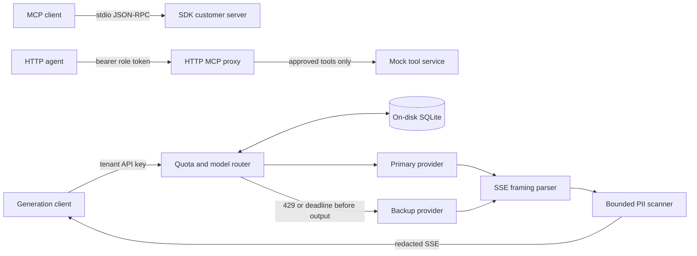

# Solution Architect assessment

This project implements four tasks in Python. It includes a customer MCP server over stdio, an HTTP proxy with tool authorization, a streaming PII filter, and a model router with SQLite quotas. The demo uses synthetic records and a local provider.

## Run locally

Run these commands from the repository with Python 3.12.

```text
python -m pip install uv==0.13.7
uv sync --locked
uv run pytest -q
uv run ruff check src tests
uv run ruff format --check src tests
uv run mypy
uv run python -m assessment.demo
```

The demo starts two loopback servers, runs all four tasks against a temporary SQLite file, reports time to first safe output, and shuts the servers down. It includes a real 3-second provider timeout. The test suite uses events and controlled clocks and runs offline after dependency installation. [Verification results](VERIFICATION.md)

For manual requests, copy `.env.example` to `.env` if you want to change the defaults. Start the mock and gateway in separate terminals.

```text
uv run uvicorn assessment.mock:app --host 127.0.0.1 --port 8001 --no-proxy-headers
uv run uvicorn assessment.app:create_app --factory --host 127.0.0.1 --port 8000 --no-proxy-headers
```

Run the stdio server independently.

```text
uv run python -m assessment.mcp_server
```

Configure an MCP client to launch that command. The server uses stdin and stdout for newline-delimited JSON-RPC and sends logs to stderr. The demo opens the session with the official SDK client.

Use `curl.exe` in PowerShell 7.3 or later and `curl` in a POSIX shell. The Python demo also works on earlier Windows PowerShell releases.

```text
curl.exe -s http://127.0.0.1:8000/mcp -H "Authorization: Bearer dev-viewer-token" -H "Content-Type: application/json" --data-raw '{"jsonrpc":"2.0","id":1,"method":"tools/list"}'
curl.exe -s http://127.0.0.1:8000/mcp -H "Authorization: Bearer dev-viewer-token" -H "Content-Type: application/json" --data-raw '{"jsonrpc":"2.0","id":2,"method":"tools/call","params":{"name":"admin_reset_key"}}'
curl.exe -s http://127.0.0.1:8000/v1/completions -H "Authorization: Bearer dev-tenant-key" -H "Content-Type: application/json" --data-raw '{"prompt":"Synthetic demo","scenario":"primary429"}'
curl.exe -N http://127.0.0.1:8000/v1/generate -H "Authorization: Bearer dev-tenant-key" -H "Content-Type: application/json" --data-raw '{"prompt":"Synthetic demo"}'
```

Other local mock scenarios are `ok`, `primary_timeout`, `backup_failure`, and `broken_stream`.

## Clinical server integration

Install the [clinical server](https://github.com/Sairajiv-13/clinical-trials-mcp-server) into its own Python environment. Set `CLINICAL_MCP_PYTHON` to that environment's Python executable and run `uv run python -m assessment.demo` from this repository.

The gateway still forwards JSON-RPC over HTTP. The downstream adapter opens an SDK stdio session to the clinical server. The demo lists its tools and calls `get_trial` through the authenticated gateway. The clinical process reads from a local synthetic registry fixture for this run.

## Tokenizer and container

The gateway uses `cl100k_base` when `TIKTOKEN_CACHE_DIR` points to a cache containing the pinned vocabulary. Populate the cache once with the same environment variable set.

```text
uv run python -c "import tiktoken; tiktoken.get_encoding('cl100k_base')"
uv run python -m assessment.demo
uv run python -m assessment.benchmark
```

Without a verified cache, the gateway uses UTF-8 byte length as a conservative input estimate. The mock and gateway use the same counter. Real provider usage settles the reservation when reported.

Build and run the loopback demo in the container.

```sh
docker build -t solution-architect-assessment:v1.0.0 .
docker run --rm solution-architect-assessment:v1.0.0
```

The tagged GitHub release includes the Linux amd64 image as a compressed Docker archive. Load it with `docker load -i solution-architect-assessment-linux-amd64.tar.gz`. [Releases](https://github.com/Sairajiv-13/solution-architect-assessment/releases)

## Architecture and transport scope



`/mcp` is a stateless HTTP JSON-RPC proxy for `tools/list` and `tools/call`. Its scope is those two methods. The stdio server handles MCP initialization and session lifecycle through the SDK. The HTTP proxy forwards requests to a separate mock service.

## Task 1: validation and protocol errors

`mcp_server.py` requires `CUST-` followed by five ASCII digits. A refund takes a finite positive JSON number and a reason of at least ten characters after trimming. The models reject extra fields, booleans as amounts, and numeric strings. Amounts use `Decimal(str(value))` after SDK parsing and are returned as strings. Floating literals retain the precision of the SDK's parsed value.

The `mcp==1.25.0` tool decorator converts validation failures and caught exceptions to tool results with `isError=True`. The assessment requires JSON-RPC error `-32602`. Registering handlers in the SDK's low-level request registry lets a handler raise `McpError` and lets the SDK send the protocol error. [Pinned SDK source](https://github.com/modelcontextprotocol/python-sdk/blob/v1.25.0/src/mcp/server/lowlevel/server.py)

The SDK's stdio reader reports malformed input as an exception. The server uses the SDK's stdin and stdout injection parameters to validate lines and return parse errors. A shared lock serializes SDK messages and rejected-line replies. The SDK still handles initialization, cancellation notifications, and result serialization. [Pinned stdio source](https://github.com/modelcontextprotocol/python-sdk/blob/v1.25.0/src/mcp/server/stdio.py)

Malformed JSON returns `-32700` with a null ID. Invalid envelopes and batches return `-32600`, unknown methods return `-32601`, and invalid parameters return `-32602`. Valid request IDs are strings or integers. The gateway rejects duplicate JSON members before forwarding. Tool notifications are ignored.

## Task 2: authorization and forwarding

`app.py` matches the bearer token against configured development roles. It forwards authenticated tool lists unchanged, so viewers can discover both tool names. A call to a name starting with `admin_` requires the `admin` role. A denied call returns `-32001` with the message `Unauthorized Tool Call` and the original request ID. It makes zero downstream requests.

Malformed JSON or envelopes return HTTP 400. Method and tool authorization errors return HTTP 200 with JSON-RPC errors. Missing or invalid credentials return HTTP 401 with a Bearer challenge. Authenticated notifications receive an empty HTTP 204 and stay at the gateway. Downstream failure returns HTTP 502 with `-32002`. An upstream deadline returns HTTP 504 with the same JSON-RPC code. Downstream JSON-RPC errors retain the code and ID and use a sanitized message.

The proxy validates tool arguments as objects and progress tokens as strings or integers. It caps requests at 64 KiB and buffered replies at 256 KiB. `MCP_TIMEOUT` defaults to five seconds for opening and reading the whole downstream response. Disconnects cancel the read and close the response. The shared HTTPX client uses configured upstream addresses, disables redirects and inherited proxies, and rejects upstream cookies. The proxy builds its own request headers and requests uncompressed replies.

## Task 3: streaming redaction policy

`provider.py` incrementally decodes UTF-8 and parses LF or CRLF SSE. Network chunks may split a line, a character, or an event. Each JSON event contains a text delta or a usage object. The optional usage event must be last and may appear once. The stream ends with `data: [DONE]`. Empty objects, duplicate members, invalid UTF-8, oversized events, and missing termination fail closed. The parser retains at most 16,384 characters for the current event.

`pii.py` scans the text separately from the SSE parser. It recognizes these patterns.

- **Email.** A local part of 1 to 64 ASCII letters, digits, or `._%+-`, followed by `@` and a dotted ASCII domain. Each domain label has 1 to 63 characters and no edge hyphens. The final label has 2 to 63 ASCII letters. Punctuation outside the match is preserved.
- **SSN.** Three, two, and four ASCII digits separated by consistent spaces or hyphens. Bare nine-digit IDs remain outside this rule.
- **Card.** From 13 to 19 ASCII digits with optional single spaces or hyphens between digit groups. Redaction requires a passing Luhn checksum and more than one distinct digit. Checksum-valid order IDs can still match.

The scanner holds uncertain text until a delimiter or a clean end of stream. It merges overlapping matches into one `[REDACTED]` marker and flushes incomplete candidates at a clean end. An upstream failure drops pending text. At character 257, it emits one marker and suppresses the candidate through its boundary, including spaced numeric continuations. This may also suppress a long ordinary word or trailing spaces.

The 256-character limit trades some false positives for bounded memory on long candidates. Completed words can leave the scanner immediately. Transport chunks and the current output event occupy memory in addition to the scanner and parser buffers. The completion endpoint uses a separate 256 KiB body cap. Both paths reject compressed upstream replies before reading the body.

Client backpressure pauses provider reads. An ASGI disconnect cancels the provider request and settles the reservation, including during stream preflight. An upstream failure before headers returns HTTP 502. A failure after output begins sends an SSE `error` event and ends the stream. Successful streams end with `done` after quota settlement. Logs omit raw prompts and generated text.

## Task 4: quota accounting and fallback

`quota.py` uses separate SQLite connections, `BEGIN IMMEDIATE` admission transactions, a 5-second busy timeout, and indexes for tenant lookup and settled-row expiry. Workers retry transient lock errors while enabling WAL on a fresh database. Expiry, budget checks, and insertion are atomic across workers sharing the database. Database work runs in worker threads, and transactions finish before provider work begins. [SQLite transaction behavior](https://www.sqlite.org/lang_transaction.html)

The default budget is 50,000 tokens per tenant per 60 seconds. The gateway hashes the bearer key and looks up the tenant in `TENANT_KEY_DIGESTS`. Several digests can share a tenant budget. SQLite stores the tenant ID and reservation data.

The quota accounts for requests as follows.

1. Count prompt tokens with the configured local tokenizer or estimate them from UTF-8 bytes. The mock reports synthetic usage and counts each output character as one token. A model adapter also needs to budget its messages, tool schemas, and provider overhead.
2. Reserve **two times** `(input estimate + max_tokens)` atomically, allowing at most a primary and a backup attempt. Deny before contacting any provider if the reservation does not fit. This deliberately reduces concurrency for requests that never need the backup.
3. An attempt starts with its full allocation charged. On successful authoritative usage, replace it with actual input plus output tokens. Missing usage, failed/429/timed-out attempts, and cancelled started attempts retain their full allocation. Unstarted backup allocations are released. This conservatively counts failures even if a provider might not bill them.
4. If reported usage exceeds an attempt allocation, record the usage as debt, return a sanitized error, and enforce the debt on later admissions. Usage above SQLite's signed 64-bit maximum settles at that maximum, which exhausts every supported tenant budget for the window. Admission subtracts charges using Python integers inside the same write transaction so multiple large debts can be evaluated safely. Exact upstream billing limits require a provider tokenizer and an enforced output contract.
5. Active reservations stay charged. At settlement, the worker acquires the SQLite write lock before it reads the clock. The settled charge stays for the full window, 60 seconds by default. Admission evicts settled rows at or before the cutoff inside its write transaction.
6. If a cancelled admission commits, the worker settles the reservation at its full amount. Active rows persist across crashes. Stop **all** workers before recovering abandoned reservations at their full amounts.

```text
uv run python -m assessment.quota runtime/quota.sqlite3 --workers-stopped
```

Recovery starts a fresh settlement window. The flag records the operator's confirmation that all gateway workers have stopped.

`router.py` gives the primary three seconds. A 429 or timeout starts one backup attempt with a separate deadline of five seconds by default. Other failures return immediately. `PROVIDER_URL` and `SECONDARY_PROVIDER_URL` can point to separate services. The demo uses two routes on one mock. Client cancellation closes local work and settles usage for the attempts that started. A remote provider may continue processing or billing after local cancellation.

The streaming deadline covers provider opening and reads. Time spent waiting for the client also counts against it. The router checks the clock before and after reading a delta, including when the delta is already buffered. It can switch to the backup before yielding the first safe text. Once output starts, an upstream failure ends that stream.

Generation errors include a code, a safe message, and a request ID also sent in `X-Request-ID`. The codes are `invalid_request` (400), `unauthorized` (401), `request_too_large` (413), `quota_exceeded` (429), `upstream_unavailable` (502), and `internal_error` (500). After the response starts, an SSE error event carries the same payload.

## Review map and interview walkthrough

| Requirement | Implementation | Evidence |
| --- | --- | --- |
| Strict customer/refund models; real protocol errors; stdout isolation | `mcp_server.py`, `protocol.py` | `test_mcp_stdio.py`: real process initialization, listing, both calls, invalid schemas, malformed wire messages, every stdout line inspected; stderr inspected separately |
| Verified roles, admin prefix filtering, transparent list | `app.py`, `config.py`, `mock.py` | `test_gateway.py`: denied/invalid/authentication requests assert zero downstream calls; header isolation and ID preservation |
| Partial-frame and partial-text redaction | `provider.py`, `pii.py` | `test_pii.py`: every two-part split, single characters, seeded multipart splits, UTF-8/SSE splits, punctuation, EOF, oversized candidates, state bounds |
| Stream cleanup, sanitization and fallback boundary | `router.py`, `app.py` | `test_router.py`, `test_gateway.py`: pull counts, closure/cancellation, disconnect before sending, pre/post-output failures, no mid-answer fallback |
| Atomic sliding window and persistence | `quota.py` | `test_quota.py`: independent connections/threads/processes, tenant isolation, clock-controlled cutoff, active rows across restart, recovery, cancellation, debt |
| 429/3-second fallback; usage reconciliation | `router.py` | `test_router.py`: primary success, retryable/nonretryable errors, real cancellation deadline, separate backup deadline, missing usage, overruns, zero provider calls on quota denial |
| Runnable integration and latency measurement | `demo.py` | Actual SDK client and loopback HTTP services; measured request-to-first-safe-text samples in `VERIFICATION.md` |

Three paths show the key decisions. `call_tool` returns a protocol error for invalid arguments. The gateway checks the role before it builds the downstream request for `admin_reset_key`. For generation, `reserve_sync` reserves both attempts before `Router.complete` contacts the primary. If the primary times out and the backup succeeds, settlement combines the primary's full allocation with the backup's reported usage.

## Deployment limits and zero-trust considerations

The demo uses loopback, synthetic bearer credentials, and a local SQLite file. A deployment would use TLS, verified workload identities, managed credentials, and an egress allowlist for the configured upstreams. Trust forwarded headers only from a known proxy and block direct access around it. For a failed connection, check identity, TLS hostname and trust, DNS, egress policy, and upstream health separately.

SQLite WAL fits workers on one host with a local disk. Use a transactional shared store for replicas on separate hosts. A database error denies work. The scanner covers the stated ASCII patterns, so a separate policy is needed for Unicode or obfuscated data. [SQLite WAL deployment limits](https://www.sqlite.org/wal.html)

The [decision records](docs/adr) cover SQLite WAL, Luhn, the 3,000 ms deadline, FastAPI, and the deployment scope.

## Submission

AI assistance was used for implementation and review. [Public submission repository](https://github.com/Sairajiv-13/solution-architect-assessment) · [Linux and Windows CI](https://github.com/Sairajiv-13/solution-architect-assessment/actions)
